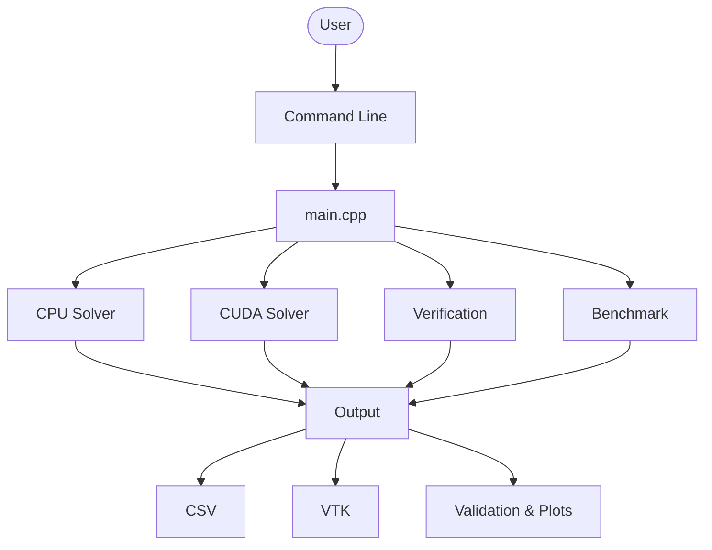
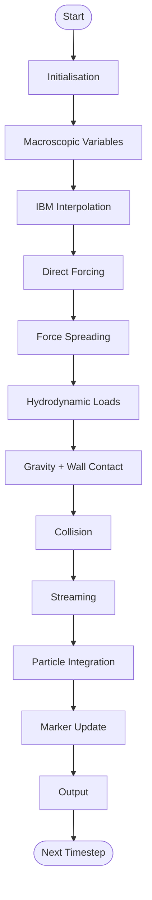
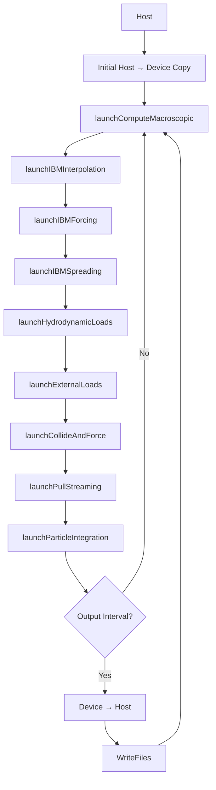
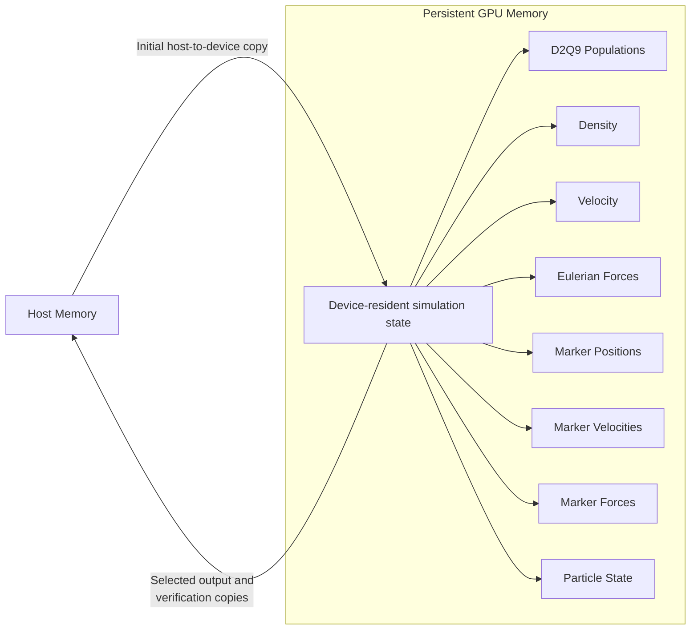
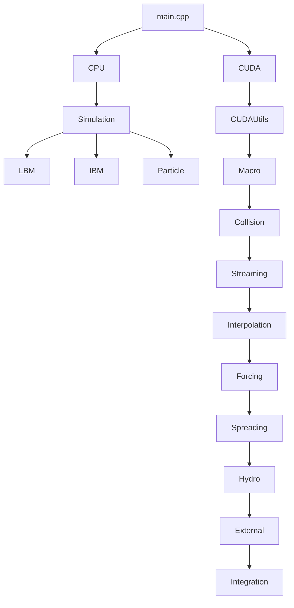
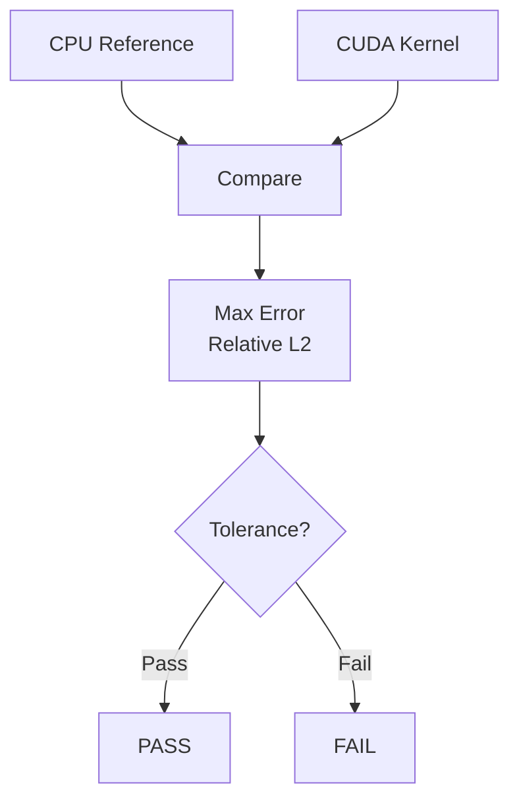
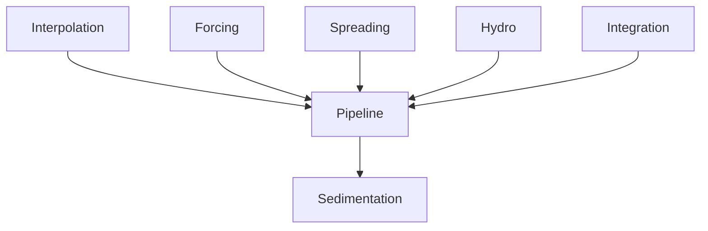
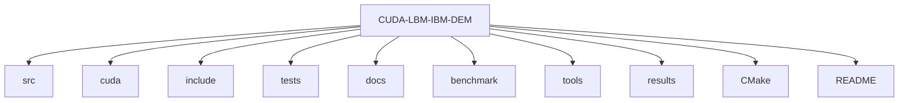

# Architecture

## CPU production path

- `LBMSolver`: D2Q9 BGK fluid solver with Guo forcing.
- `IBMParticle`: rigid circular particle state and Lagrangian markers.
- `IBMCoupling`: interpolation, direct forcing, spreading, force and torque
  accumulation.
- `Simulation`: sedimentation timestep orchestration.
- `WallContact`: four-wall linear spring-dashpot contact.
- `VTKWriter`: ParaView output.

## CUDA production path under construction

- `LBMSolverCUDA`: persistent device-resident fluid state.
- `IBMParticleCUDA`: persistent device-resident particle and marker state.
- Independent CUDA launchers retain one-to-one mappings to the CPU LBM and IBM
  operations.
- `--verify-ibm-pipeline` compares the connected hydrodynamic GPU path with the
  CPU implementation over repeated timesteps.

Gravity, buoyancy, wall contact, benchmark output, and the final CUDA
sedimentation runner are intentionally deferred to subsequent commits.

# CUDA-LBM-IBM-DEM Software Architecture

## Overview

CUDA-LBM-IBM-DEM is organized into four major layers:

1. User Interface
2. Simulation Engine
3. Verification Framework
4. Validation and Benchmark Tools

The CPU and CUDA implementations share the same numerical algorithms.
The CUDA implementation replaces the computational kernels while preserving
the same mathematical formulation and verification workflow.

# Figure 1 — Overall software architecture

# Figure 2 — CPU execution pipeline

# Figure 3 — CUDA execution pipeline

# Figure 4 — Persistent GPU memory

# Figure 5 — Source-code dependencies

# Figure 6 — Verification workflow

# Figure 7 — Complete verification hierarchy

# Figure 8 — Repository organization
